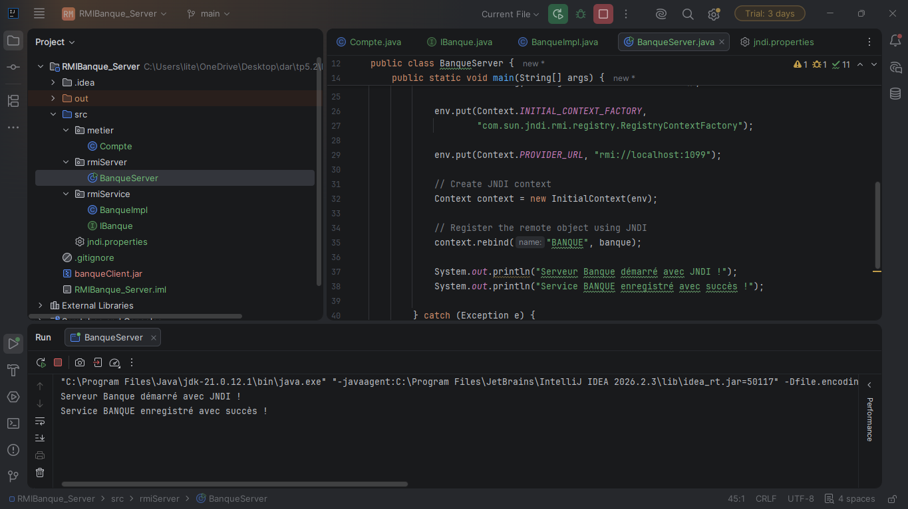
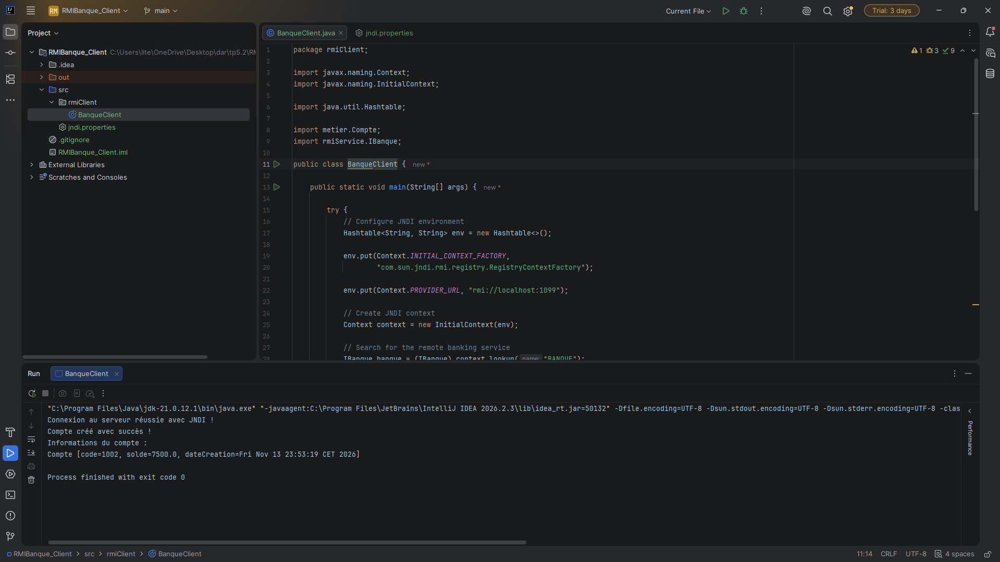

# TP 5 – Activité 5-2 : Service de banque avec Java RMI et JNDI

## Informations générales

- **Université :** Faculté des Sciences de Sfax
- **Département :** Informatique et Communications
- **Année universitaire :** 2026–2027
- **Matière :** Développement d'applications réparties
- **Niveau :** LSI 3
- **Enseignante :** Zeineb DAOUD

---

## 1. Objectifs du TP

L'objectif de ce TP est de développer une application répartie de gestion des comptes bancaires en utilisant Java RMI (Remote Method Invocation) et JNDI (Java Naming and Directory Interface).

Cette application permet de :

- Créer un compte bancaire avec un code et un solde initial.
- Vérifier si un compte existe déjà.
- Consulter les informations d'un compte bancaire à partir de son code.
- Assurer la communication entre un client et un serveur distant avec Java RMI.
- Utiliser JNDI pour l'enregistrement et la recherche des objets distants.

## 2. Environnement de développement

- Java JDK
- IntelliJ IDEA
- Java RMI
- JNDI
- Git et GitHub

## 3. Structure du projet

Le projet est composé de deux applications Java indépendantes :

### 3.1. Projet RMIBanque_Server

Ce projet représente le serveur central qui assure la gestion des comptes bancaires.

```text
RMIBanque_Server/
│
├── src/
│   ├── metier/
│   │   └── Compte.java
│   │
│   ├── rmiService/
│   │   ├── IBanque.java
│   │   └── BanqueImpl.java
│   │
│   ├── rmiServer/
│   │   └── BanqueServer.java
│   │
│   └── jndi.properties
│
└── banqueClient.jar
```

### 3.2. Projet RMIBanque_Client

Ce projet représente l'application cliente qui communique avec le serveur pour créer et consulter les comptes bancaires.

```text
RMIBanque_Client/
│
├── src/
│   ├── rmiClient/
│   │   └── BanqueClient.java
│   │
│   └── jndi.properties
│
└── banqueClient.jar
```

## 4. Développement du serveur

### 4.1. Classe Compte

La classe `Compte` est définie dans le package `metier`.

Elle contient trois attributs :

- `code` : identifiant du compte de type int.
- `solde` : solde bancaire de type double.
- `dateCreation` : date de création du compte de type Date.

La classe implémente l'interface `Serializable` afin de permettre la transmission des objets entre le client et le serveur.

### 4.2. Interface distante IBanque

L'interface `IBanque`, définie dans le package `rmiService`, étend l'interface `Remote`.

Elle définit deux méthodes distantes :

- `creerCompte(Compte c)` : permet de créer un compte bancaire.
- `getInfoCompte(int code)` : permet de consulter les informations d'un compte.

Les méthodes déclarent l'exception `RemoteException`.

### 4.3. Implémentation BanqueImpl

La classe `BanqueImpl` implémente l'interface `IBanque` et hérite de `UnicastRemoteObject`.

Elle utilise une collection `HashMap` pour stocker les comptes bancaires.

Elle assure :
- La création des comptes.
- La vérification de l'existence d'un compte avant sa création.
- La recherche d'un compte à partir de son code.

### 4.4. Classe BanqueServer

La classe `BanqueServer` permet de démarrer le serveur RMI sur le port 1099 et d'enregistrer l'objet distant pour qu'il soit accessible aux clients.


## 5. Développement du client

### 5.1. Création du fichier JAR

Un fichier JAR nommé `banqueClient.jar` a été généré à partir du projet serveur.

Il contient uniquement les classes nécessaires au client :

- `metier/Compte.class`
- `rmiService/IBanque.class`

Ce fichier est ensuite ajouté au Classpath du projet client.

### 5.2. Classe BanqueClient

La classe `BanqueClient` permet de se connecter au serveur RMI et d'invoquer les méthodes distantes.

Elle permet de :
- Rechercher le service bancaire distant.
- Créer un nouveau compte bancaire.
- Consulter les informations du compte créé.


## 6. Exécution de l'application avec RMI

Le serveur est démarré en premier, puis le client est exécuté.

Le résultat obtenu confirme le bon fonctionnement de la communication entre les deux applications.

**Résultat de l'exécution du serveur :**



**Résultat de l'exécution du client :**



Exemple de résultat :

```text
Connexion au serveur réussie !
Compte créé avec succès !
Informations du compte :
Compte [code=1001, solde=5000.0, dateCreation=...]
```

## 7. Intégration de JNDI

Dans cette étape, l'application a été modifiée afin d'utiliser JNDI pour l'enregistrement et la recherche des objets distants.

### 7.1. Configuration JNDI

Un fichier `jndi.properties` a été créé dans le dossier `src` des deux projets.

Son contenu :

```properties
java.naming.factory.initial=com.sun.jndi.rmi.registry.RegistryContextFactory
java.naming.provider.url=rmi://localhost:1099
```

### 7.2. Modification du serveur

La classe `BanqueServer` a été modifiée pour utiliser `InitialContext` et la méthode `rebind()` afin d'enregistrer l'objet distant.

### 7.3. Modification du client

La classe `BanqueClient` utilise désormais `InitialContext` et la méthode `lookup()` pour rechercher le service bancaire distant.

### 7.4. Test de l'application avec JNDI

Après la modification, le serveur et le client ont été relancés afin de vérifier le bon fonctionnement de la communication.


Exemple de résultat obtenu :

```text
Connexion au serveur réussie avec JNDI !
Compte créé avec succès !
Informations du compte :
Compte [code=1002, solde=7500.0, dateCreation=...]
```

## 8. Conclusion

Ce TP nous a permis de mettre en pratique les concepts de développement d'applications réparties avec Java.

Nous avons appris à créer une communication client/serveur avec Java RMI, à définir des interfaces distantes, à transmettre des objets sérialisables et à gérer des comptes bancaires à distance.

Nous avons également découvert l'intégration de JNDI avec RMI pour faciliter l'enregistrement et la recherche des objets distants.

Les tests réalisés ont confirmé le bon fonctionnement de l'application avec RMI et JNDI.
